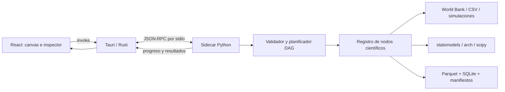

# Arquitectura de Quantlabs-Econometrics

Versión de diseño: 0.1.0. Fecha: 2026-11-01. Estado: diseño objetivo. Para el alcance real de la alpha 0.2.0, consultar [DESARROLLO.md](DESARROLLO.md).

## Objetivo y límites

Aprender estadística y econometría construyendo flujos visuales reproducibles, desde datos hasta inferencia y reportes. Destinos: macOS ARM64 y x86_64 y Windows x86_64. Windows ARM64 se evaluará después. Ejecución local y ejemplos sintéticos sin conexión; la descarga de datos necesita red. La entrega inicial 0.1.0 fue documental. La alpha 0.2.0 añade motor e interfaz local; aún no incluye instaladores.

## Decisiones

| Capa | Decisión | Motivo y límite |
|---|---|---|
| Escritorio | Tauri 2 + Rust | Contenedor y permisos de archivos; requiere compilar y firmar por plataforma |
| Interfaz | React + TypeScript | Componentes tipados, inspector y accesibilidad |
| Grafo | React Flow, paquete `@xyflow/react` | Editor de nodos; el backend valida y ejecuta el grafo |
| Estado | Zustand | Edición, selección y deshacer; separado de resultados científicos |
| Gráficos | Plotly.js | Series, distribuciones, residuos, intervalos |
| Motor | Python 3.12 objetivo inicial | Ecosistema científico; validar ruedas antes de fijar patch |
| Comunicación | JSON-RPC 2.0 sobre stdin/stdout | Rust administra un sidecar Python sin servidor HTTP local |
| Tablas | pandas + Parquet/PyArrow | Índice explícito, tipos y persistencia por artefacto |
| Historial local | SQLite | Metadatos, ejecuciones y progreso; no tablas masivas dentro del grafo |
| Empaquetado | PyInstaller + Tauri | Sidecar independiente para cada sistema y arquitectura |

FastAPI queda reservado para una futura API web o servicio remoto, con ADR y autenticación propios. No es necesario para el IPC inicial.



## Módulos y estructura futura

```text
apps/desktop/       React, canvas, inspector, lecciones, accesibilidad
apps/desktop/src-tauri/  Rust, permisos y ciclo de vida del sidecar
packages/contracts/     Esquemas JSON de grafo, resultados y mensajes
engine/                 Adaptadores de datos, DAG, estimadores y diagnósticos
curriculum/             Lecciones originales y referencias B01-B36
examples/               Grafos y datos sintéticos pequeños
scripts/                Verificación documental y sincronización Git (existentes)
tests/                  Pruebas de automatización (existentes)
docs/                   Diseño y trazabilidad (existentes)
```

Las carpetas futuras se crearán con código real en su fase correspondiente.

## Contratos de nodos y ejecución

Cada definición de nodo debe declarar `type`, `node_version`, parámetros, puertos tipados, requisitos, referencias bibliográficas y función ejecutora permitida. Tipos iniciales: Dataset, Series, DesignMatrix, FittedModel, TestResult, Forecast, PlotSpec y Report. Los enlaces identifican nodo y puerto de origen/destino. Los resultados científicos se referencian por ID de artefacto; no se transportan DataFrames completos como estado de interfaz.

El documento del proyecto incluye `schema_version`, `project_id`, versión de aplicación, nodos, conexiones y coordenadas de UI. La versión del esquema evoluciona independientemente de la versión del programa. Las migraciones conservan el original y rechazan esquemas posteriores desconocidos.

1. Validar esquema, límites de tamaño, IDs únicos, existencia de nodos/puertos, aridad y compatibilidad de tipos.
2. Rechazar ciclos y nodos desconocidos antes de ejecutar; ordenar topológicamente.
3. Validar precondiciones científicas: frecuencia, índice, unidades, tamaño de muestra, rango y variables requeridas.
4. Calcular clave de caché con parámetros canónicos, huellas de entradas, versiones del motor/nodo/dependencias y semilla.
5. Ejecutar fuera del hilo de interfaz con estados queued/running/succeeded/failed/cancelled/skipped. Si falla un padre, omitir sus descendientes y preservar ramas independientes.
6. Emitir progreso con `run_id`, `node_id` y `request_id`. Guardar artefactos mediante escritura temporal y renombrado atómico.
7. Cancelación cooperativa; para bibliotecas bloqueantes, finalizar el worker después de un plazo configurable. Una ejecución cancelada no se presenta como resultado completo.

El dispatcher usa un registro cerrado de funciones; jamás `eval`, `exec` o ejecución arbitraria de Python recibida desde el canvas. Límite inicial propuesto: 500 nodos, 2.000 conexiones, 1 millón de filas por tabla y 60 segundos por nodo; configurable y sujeto a benchmarks. La concurrencia inicial será un worker científico y una cola para limitar memoria.

## IPC y errores

Métodos propuestos: `engine.health`, `nodes.list`, `project.validate`, `run.start`, `run.cancel`, `artifact.preview`, `artifact.export`. Mensajes JSON delimitados por salto de línea; un escritor serializa stdout y logs van a stderr. JSON estricto: NaN e infinitos se normalizan a null con advertencias. Cada respuesta devuelve resultado o error estructurado, nunca ambos. Errores: INVALID_GRAPH, TYPE_MISMATCH, DATA_UNAVAILABLE, INSUFFICIENT_SAMPLE, RANK_DEFICIENT, NON_CONVERGENCE, CANCELLED y INTERNAL_ERROR. No incluir rutas sensibles ni trazas internas en el reporte exportado.

Al iniciar, Rust verifica versión del protocolo y salud del sidecar. Al cerrar, termina procesos hijos. Tauri solo autoriza el binario integrado y operaciones acotadas sobre carpetas elegidas por el usuario. Los plugins de usuario ejecutables quedan fuera de la versión inicial.

## Datos y reproducibilidad

Adaptadores: World Bank mediante wbdata, CSV/Excel local y simulación con generador/semilla explícitos. Otros proveedores requieren adaptadores posteriores. Descargar con timeout, reintentos limitados, backoff, paginación y caché; conservar respuesta original y fecha de recuperación. La firma de wbdata se comprobará contra la versión fijada, sin copiar ciegamente el parámetro `data_date` del boceto adjunto.

Esquema de serie: country_code, indicator_code, period, frequency, value, unit, source y revision cuando esté disponible. La clave país-indicador-período debe ser única. Ordenar antes de rezagar o diferenciar, y agrupar por país para impedir cruces de series. Un año ausente no equivale a cero. Conversión de frecuencia e imputación requieren decisiones visibles. No aplicar `dropna` global silencioso: informar filas y países descartados y la muestra efectiva de cada modelo.

El manifiesto de ejecución registra fechas ISO 8601 UTC, zona del usuario cuando corresponda, consulta/proveedor, filtros, unidades, huellas SHA-256, transformaciones, tamaños de muestra, grafo y hash, versiones del esquema/nodos/motor, versión de aplicación, commit Git si está disponible, Python/OS/dependencias/BLAS, semilla, convergencia y advertencias. El snapshot permite repetir un análisis aunque el proveedor revise las series. Los manifiestos son archivos locales de ejecución; docs/VERSIONES.md registra decisiones del proyecto, no datos privados completos.

## Exactitud científica

OLS usa QR/SVD de la biblioteca, sin invertir explícitamente X'X. Detectar rango deficiente, constantes duplicadas y ausencia de grados de libertad. Distinguir regresión múltiple (una respuesta y varios regresores) de modelos con varias respuestas. Mostrar covarianza clásica, HC o HAC seleccionada y sus supuestos; corregir errores estándar no transforma el estimador en una regresión robusta a atípicos.

Validar dominio de logaritmos y denominadores. No hacer log del crecimiento porcentual si incluye cero o valores negativos. Transformar niveles positivos o elegir una transformación justificada. Conservar unidades, base de índices, nominal/real y per cápita.

Para series: ADF/KPSS, ACF/PACF, residuos, frecuencia regular, horizonte e intervalos. Entrenamiento y evaluación en orden temporal; escaladores e imputadores se ajustan dentro de cada partición de entrenamiento. Cointegración exige documentar orden de integración y términos deterministas. ARCH/GARCH muestra restricciones, distribución, convergencia y residuos estandarizados. GARCH multivariado necesita motor adicional validado; no se declara soportado por la sola presencia de `arch`.

P-valores no prueban causalidad. SEM y variables instrumentales requieren supuestos de identificación explícitos. HMM y mezclas gaussianas son modelos distintos: la dependencia de estados temporales no aparece por ajustar una mezcla. AIC/BIC se comparan sobre muestras y verosimilitudes compatibles. Backtests incluyen costos, disponibilidad histórica, sesgos de selección y supervivencia.

## Interfaz y aprendizaje

Canvas con búsqueda de nodos, puertos diferenciados por color y etiqueta, zoom, minimapa, selección, deshacer/rehacer y ejecución de subgrafo. Inspector: parámetros, ecuación, supuestos, muestra efectiva, interpretación, diagnósticos y capítulo de referencia. Estados vacíos y errores explican la corrección necesaria. Navegación por teclado, foco visible, contraste y alternativas tabulares para gráficos.

Lecciones originales con objetivo, prerrequisitos, ejemplo reproducible, predicción del estudiante, ejecución y pregunta de interpretación. Progreso local en SQLite. No reproducir capítulos. Reportes HTML/Markdown incluyen tablas, gráficos, supuestos y manifiesto; exportar PDF queda como ampliación.

## Pruebas y distribución

Pruebas unitarias de cada nodo contra resultados conocidos de bibliotecas; pruebas de DAG inválido, caché, cancelación y errores. Datos sintéticos con tolerancias numéricas; integración World Bank separada y con snapshots, sin red obligatoria en pruebas normales. Pruebas de extremo a extremo: abrir ejemplo, editar parámetros, ejecutar, guardar, reabrir y exportar. Probar rutas Unicode y espacios, CSV regionales, fechas, datos faltantes y proyectos incompatibles.

CI actual verifica solo documentación y automatización en macOS/Windows. La fase de aplicación añadirá TypeScript, pruebas científicas y builds nativos, sidecars con sufijo target triple, firma/notarización macOS y firma Windows. Verificar licencias transitivas y claves de firma mediante secretos de CI. No anunciar instaladores hasta verificar instalación y funcionamiento sin Python externo en cada destino.

## Fuentes técnicas y decisiones pendientes

Consultadas el 2026-11-01: [Tauri: sidecars](https://v2.tauri.app/develop/sidecar/) y [React Flow](https://reactflow.dev/). Estas fuentes respaldan integración y paquete, no un benchmark de rendimiento ni versiones exactas del stack completo.

Pendientes: patches y lockfiles, biblioteca SEM/HMM/IV-GMM, motor GARCH multivariado, restricciones mínimas de OS, firma y distribución de actualizaciones. Cada decisión debe fijar versión, licencia, pruebas y motivo en VERSIONES.md antes de adoptarse.
