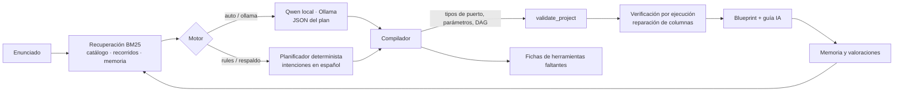

# Segundo cerebro · del enunciado al blueprint

Versión del cerebro: 1.0.0 · aplicación 0.9.0 · 2026-11-04. Estado: **implementado y verificado con pruebas automáticas**; la calidad de los planes con Qwen depende del modelo local instalado y se evalúa caso a caso.

El segundo cerebro convierte una petición en lenguaje natural («estima el consumo sobre el ingreso con errores robustos y revisa heterocedasticidad») en un **blueprint**: un proyecto Quantlabs con nodos conectados, parámetros, guía paso a paso y lista de herramientas que faltan. Usa la misma mecánica de construcción que los 28 recorridos: catálogo cerrado de nodos, puertos tipados, validador DAG del motor y una guía con un paso por nodo.

## Principios

| Principio | Cómo se cumple |
|---|---|
| Local y privado | RAG en Python puro (BM25) sobre archivos del repositorio; LLM vía Ollama en `127.0.0.1`. Un host remoto exige `QL_BRAIN_ALLOW_REMOTE=1`. |
| Sin código generado | El modelo solo elige tipos de nodo del catálogo y parámetros declarados en `defaults`. No hay `eval`, `exec` ni nodos dinámicos. |
| Verificable | Todo blueprint pasa por `validate_project`; si los datos son locales se ejecuta y se reparan columnas con las vistas previas reales. |
| Honesto con los huecos | Lo que el catálogo no cubre se registra como **ficha de herramienta faltante**, nunca se simula con otro nodo. |
| Degradación elegante | Sin Ollama, sin modelo o con respuesta inválida, el planificador determinista produce un plan válido. |

## Arquitectura



Código en `engine/quantlabs/brain/`:

| Módulo | Responsabilidad |
|---|---|
| `knowledge.py` | Corpus (fichas de nodos, 28 recorridos, bibliografía B01–B36, blueprints valorados 👍) e índice BM25 con plegado de acentos. |
| `intents.py` | Detección de fuente (sintética, Banco Mundial con país/indicador/años, Wooldridge, CSV), intenciones → nodos y escenarios sintéticos adecuados. |
| `llm.py` | Cliente Ollama: elige modelo (`QL_BRAIN_MODEL` o preferencia Qwen), degrada de esquema JSON → `format: json` → texto (los runners MLX no admiten salida estructurada). |
| `compiler.py` | Plan → proyecto: limpia parámetros con `defaults`/`choices`, conecta cada entrada al último productor compatible (o al indicado en `inputs`), añade fuente si falta, descarta pasos imposibles, dispone el lienzo y crea la guía. |
| `store.py` | `history.jsonl`, `feedback.json` y `tool-requests.json` en `.quantlabs/brain/` (o `QL_BRAIN_DIR`), con escritura atómica. |
| `service.py` | Orquesta recuperar → planear → compilar → verificar → recordar y expone los métodos RPC. |

## Uso

### En el escritorio o navegador

1. Pulsa **Cerebro IA** en la barra del lienzo.
2. Escribe el enunciado (Ctrl/⌘+Enter construye). Elige motor: *Automático*, *Solo Qwen* o *Solo reglas*. Marca *Verificar con Banco Mundial* si el flujo necesita red.
3. Revisa pasos, estado de verificación por nodo, columnas reparadas, pasos descartados y herramientas faltantes.
4. **Abrir en canvas** o **Abrir y ejecutar**. La guía paso a paso aparece con el módulo `IA`.
5. Valora con 👍/👎. Los blueprints útiles alimentan la recuperación de futuros enunciados.

Las pestañas **Herramientas faltantes** y **Memoria** muestran las fichas pendientes (con estado pendiente/planificada/descartada) y el historial reutilizable.

### Línea de órdenes

```sh
uv run python -m quantlabs.brain status
uv run python -m quantlabs.brain plan "Analiza la inflación de México 2000-2023 con ARIMA" --network -o blueprint.json
uv run python -m quantlabs.brain plan "Regresión múltiple con diagnóstico" --engine rules
uv run python -m quantlabs.brain gaps --markdown
uv run python -m quantlabs.brain history
```

Ejecuta con `PYTHONPATH=engine` si no usas los arrancadores. `blueprint.json` se abre desde **Proyectos → Importar JSON**.

### JSON-RPC

| Método | Parámetros | Resultado |
|---|---|---|
| `brain.status` | — | Versión, herramientas, estado de Ollama, memoria y fichas pendientes |
| `brain.plan` | `prompt`, `engine` (`auto`/`ollama`/`rules`), `allow_network`, `verify` | `project`, `plan`, `engine`, `model`, `verification`, `gaps`, `dropped`, `notes`, `trace` |
| `brain.history` | `limit` | Últimos blueprints con valoración |
| `brain.feedback` | `id`, `value` (`up`/`down`/`null`) | Valoración guardada |
| `brain.gaps` | `status` opcional | Fichas ordenadas por número de solicitudes |
| `brain.gaps.update` | `id`, `status` | Ficha actualizada |

`brain.plan` dispone de 180 s en Electron y en el puente de desarrollo; el resto de métodos conserva 60 s.

## Instalar el modelo local

```sh
brew install ollama        # o la distribución oficial
ollama serve               # si no está ya activo en 127.0.0.1:11434
ollama pull qwen3.5:4b
```

Variables opcionales: `QL_BRAIN_MODEL` (nombre exacto), `QL_BRAIN_OLLAMA_URL`, `QL_BRAIN_TIMEOUT` (segundos, 150 por defecto), `QL_BRAIN_DIR`. Probado en este equipo con Ollama 0.40.6 y `qwen3.5:4b` (runner MLX): un plan tarda ~50 s en frío.

## Mecánica de construcción respetada

1. **Fuente primero.** Si el plan no tiene fuente se añade `synthetic` con un escenario coherente (p. ej. `cointegrated` para cointegración, `clusters` para k-means).
2. **Parámetros cerrados.** Solo claves de `defaults`; números convertidos al tipo del valor por defecto; opciones validadas con `choices`.
3. **Puertos tipados.** Cada entrada recibe exactamente una conexión del mismo tipo; `compare_models` y otros nodos con varias entradas usan `inputs` explícitos del plan o los productores más recientes distintos.
4. **DAG válido.** El proyecto pasa `validate_project` (sin ciclos, ≤100 nodos, IDs únicos).
5. **Guía completa.** Un paso por nodo con instrucción (el «por qué» del plan), resultado esperado y pregunta final; `missing_tools` enumera los huecos.
6. **Verificación.** Con datos locales se ejecuta el flujo hasta cuatro rondas; los fallos de columnas se reparan con las columnas numéricas reales del puerto de entrada.

## Ciclo de herramientas faltantes

1. El cerebro detecta el hueco (modelo o reglas) y crea/actualiza la ficha `tool-requests.json` con propósito, puertos sugeridos, módulo curricular, enunciados de origen y contador.
2. Se prioriza por número de solicitudes (`brain gaps --markdown`).
3. Implementación como nodo real: función en `engine/quantlabs/`, ficha en `nodeCatalog.json`, prueba numérica contra statsmodels/scipy, documentación en [HERRAMIENTAS.md](HERRAMIENTAS.md).
4. Al registrarse el tipo en el catálogo, la ficha pasa automáticamente a `implemented` y el cerebro la usa en los siguientes blueprints.

## Límites conocidos

- Qwen 4B puede elegir parámetros subóptimos; el compilador los corrige solo cuando hay evidencia (opciones inválidas o columnas inexistentes). Revisa siempre la guía.
- La verificación no consulta el Banco Mundial salvo que se active; CSV propio exige cargar el archivo.
- La recuperación es léxica (BM25); no hay embeddings.
- Un blueprint verificado es ejecutable, no una validación científica de la especificación.
